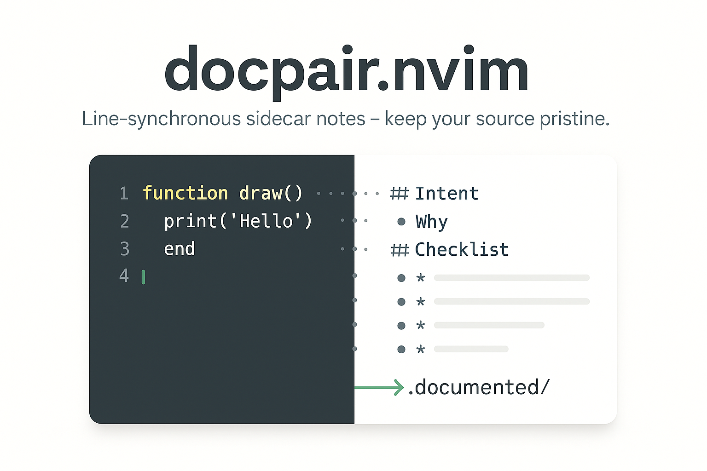

# docpair.nvim

**Read the code on the left. Read and edit its documentation on the right.**

Docpair opens a managed pair of Neovim windows. The left window contains your
source file; the right window shows documentation associated with that file.
There are two ways to use it:

- **Edit comments that belong in the source.** Move through your code and read
  the relevant comment on the right. Edit its text there without typing comment
  prefixes on every line. The changes go back into the original source buffer.
- **Keep separate notes about a file.** Write explanations, review notes, or
  learning material in a companion file. These notes do not change the source.

The three comment views and the external notes view serve different purposes.
You can switch between them in the same pair.



*The screenshot shows the external notes workflow. Comment views use the same
left/right arrangement, but show the selected comment rather than a complete
notebook.*

## Contents

- [Requirements](#requirements)
- [Install and configure with lazy.nvim](#install-and-configure-with-lazynvim)
- [Shortcuts: views versus windows](#shortcuts-views-versus-windows)
- [Try it with a C file](#try-it-with-a-c-file)
- [The four documentation views](#the-four-documentation-views)
- [Which comment belongs to which code?](#which-comment-belongs-to-which-code)
- [Create and edit documentation](#create-and-edit-documentation)
- [External notes and their files](#external-notes-and-their-files)
- [Saving, undo, and drafts](#saving-undo-and-drafts)
- [Buffers, windows, tabs, and sessions](#buffers-windows-tabs-and-sessions)
- [Command reference](#command-reference)
- [Configuration reference](#configuration-reference)
- [Which-Key and troubleshooting](#which-key-and-troubleshooting)
- [Development and tests](#development-and-tests)

## Requirements

| Neovim version | Available behavior |
| --- | --- |
| 0.11 or newer | Comment editing, external notes, paired windows, and hiding whole comment lines in the source window |
| 0.10 | Comment editing, external notes, and paired windows; source comments remain visible |
| Older than 0.10 | The plugin stays disabled; `:Documented` explains the minimum version |

The compatibility checks have been run on **0.10.4, 0.11.5, and 0.12.6**.
Run `:checkhealth docpair` to check the version and executable used by your
running editor.

A Tree-sitter parser for your language improves the association between comments
and code. It is optional: without one, Docpair uses the nearest preceding
recognized comment. An LSP server is not required. Neither Python nor a Markdown
renderer is required to use the plugin.

## Install and configure with lazy.nvim

This example defines **five global normal-mode shortcuts**. They are available
in both windows of a Docpair pair. It disables Docpair's built-in local mappings
so that the example uses one consistent set of keys.

If your setup imports plugin specifications from `lua/plugins/`, save the
following as `~/.config/nvim/lua/plugins/docpair.lua`. Replace an existing
Docpair specification instead of keeping two competing configurations.

The example uses your existing `<leader>`. For **Space** shortcuts,
`vim.g.mapleader = " "` must already be set in your `init.lua` **before**
lazy.nvim sets up plugins. Keep that assignment in your central configuration;
do not reset the leader in this plugin file.

```lua
return {
  "IstiCusi/docpair.nvim",
  main = "docpair",
  lazy = false,

  opts = {
    initial_view = "text",
    views = { "text", "markdown", "raw", "notes" },
    comments = {
      hide = true,
      debounce_ms = 80,
    },
    info_filetype = "markdown",

    -- Define our shortcuts once, in the global keys table below.
    mappings = {
      cycle = false,
      create = false,
      source = false,
    },
  },

  keys = {
    { "<leader>pp", "<cmd>Documented!<CR>", mode = "n", silent = true,
      desc = "Docpair: open pair" },
    { "<leader>pm", "<cmd>DocumentedView<CR>", mode = "n", silent = true,
      desc = "Docpair: next documentation view" },
    { "<leader>pa", "<cmd>DocumentedAdd<CR>", mode = "n", silent = true,
      desc = "Docpair: open or add comment" },
    { "<leader>ps", "<cmd>DocumentedSource<CR>", mode = "n", silent = true,
      desc = "Docpair: show/hide source comments" },
    { "<leader>pq", "<cmd>DocumentedClose<CR>", mode = "n", silent = true,
      desc = "Docpair: close pair" },
  },
}
```

The same complete specification is in [examples/lazy.lua](examples/lazy.lua).
The specification is self-contained and does not require Which-Key.
`main = "docpair"` tells Lazy which module receives `opts`; an extra
`config = function() require("docpair").setup(...) end` is unnecessary here.

If your configuration already uses any of these five complete key sequences,
choose alternatives in `keys`. The example does not clear your other mappings
or redefine the Space prefix itself.

## Shortcuts: views versus windows

With Space as your leader, press the listed keys **in sequence in normal mode**.

| Shortcut | Action | What changes? |
| --- | --- | --- |
| **Space p p** | Open Docpair for the current file in the current tab | Adds the documentation window. If this file is already paired in the current window, reuses that pair. It is not an open/close toggle. |
| **Space p m** | Cycle the documentation view | Changes what the right window displays: `text → markdown → raw → notes → text`. Keeps focus in your current window. |
| **Space p a** | Open the associated comment, or create one if none is selected | Uses the **left source cursor** as the location, then focuses the right window for editing. |
| **Space p s** | Show/hide source comments in this pair | Reveals the complete source on the left, or returns to the code-focused display. Requires hiding to be enabled and Neovim 0.11+. |
| **Space p q** | Close the current pair | Closes its managed windows with normal protection for unsaved buffers. It does not delete the files. |

Open a pair before using `pm`, `pa`, or `ps`. These commands act on the
pair containing the focused window. Outside a pair, they ask you to open
`:Documented` first.

**Changing the view and changing the focused window are separate actions.**
Use Neovim's ordinary window navigation to move between left and right:

| Keys | Action |
| --- | --- |
| `Ctrl-W`, then lowercase `l` | Focus the window to the right |
| `Ctrl-W`, then lowercase `h` | Focus the window to the left |

If your configuration maps `Ctrl-L` and `Ctrl-H` to window navigation, keep
using those. Docpair does not define them. Lowercase `h/l` moves focus;
uppercase `H/L` rearranges windows in Neovim.

The example deliberately uses **`pm` for the documentation mode** and does not
assign `pv` or `g<Tab>`. The plugin's built-in defaults are documented
[below](#built-in-mappings).

## Try it with a C file

Save this as `docpair-demo.c`:

```c
/**
 * # Clamp a measurement
 *
 * Keep the result between zero and the supplied limit.
 */
int clamp_value(int value, int limit)
{
    /// Negative measurements become zero.
    if (value < 0) {
        return 0;
    }

    if (value > limit) {
        return limit;
    }
    return value;
}

int twice(int value)
{
    return value * 2;
}
```

1. Open the file and place the cursor on `int clamp_value(...)`.
   Press **Space p p**. The code stays on the left; the text headed
   `# Clamp a measurement` appears on the right.
2. Press **Space p m** once. The right window becomes a Markdown buffer.
   The text is the same; its presentation changes. Focus stays on the left.
3. Press `Ctrl-W`, then `l`. Edit the explanation in the right window,
   leave insert mode, and run `:write`. This saves **docpair-demo.c**, including
   the edited comment and all its code.
4. Return with `Ctrl-W`, then `h`. Press **Space p s** to inspect the complete
   source. The comment delimiters are still there. Press it again to hide the
   recognized comment blocks.
5. With a C Tree-sitter parser available, put the source cursor on
   `return 0;`. The right window selects the smaller comment associated with
   the enclosing `if` statement. Move to `return value;`: the function-level
   explanation is selected again.
6. With that parser, move to the declaration of `twice` and press
   **Space p a**. There is no associated comment there, so Docpair inserts one
   and focuses the document window. Type an explanation and save.
7. Run `:DocumentedView notes`. You now see a separate notebook. Write a note
   and run `:write` to save the notebook. Return to comments with
   `:DocumentedView text`.
8. Press **Space p q** when finished with the pair.

Steps 5 and 6 depend on syntax scopes. Without a parser, the nearest preceding
comment remains selected until another comment starts; even `twice` may still
select the preceding comment. The window bar shows which association is in use.

## The four documentation views

| View | What you see and edit | Where `:write` saves it |
| --- | --- | --- |
| `text` | The selected comment body, with language delimiters and per-line comment prefixes removed | The original source file |
| `markdown` | The same comment body, using the Markdown filetype | The original source file |
| `raw` | The complete selected comment, including delimiters and indentation | The original source file |
| `notes` | A separate notebook associated with the source file | The notebook file |

### Text and Markdown: two presentations of the same comment

For this source:

```c
/**
 * # Result
 *
 * Return the cached value.
 */
```

Both `text` and `markdown` expose this editable content:

```markdown
# Result

Return the cached value.
```

The text view is plain text. The Markdown view sets Neovim's Markdown filetype,
syntax, and concealment options. Its appearance depends on your highlighting
configuration and any renderer you have installed. Docpair does not bundle a
rich preview renderer.

Switching between the two views does not create a second document, convert the
comment, or change the source undo history. XML documentation tags, Javadoc,
reStructuredText, or other markup remain the text you wrote.

### Raw: inspect the actual comment

Use `:DocumentedView raw` to see and edit the complete comment as it appears
in the source. The window bar calls this **Original**. Edits must remain one
complete standalone comment of the same kind: a line-comment block or a block
comment. Replacing it with executable code or an incomplete delimiter is rejected
and retained as a draft.

### Notes: write material outside the source

Use this for review checklists, longer explanations, personal annotations, or
notes about files you cannot modify. Unlike comment views, it shows the entire
companion notebook and couples its vertical position to the source by line
number. Source comments remain visible in this mode. Moving through notes can
therefore move the source cursor too. When you return to a comment view, the
current source cursor determines which comment appears.

Comment views keep the two cursors and scroll positions independent. Reading
further down a long comment does not move the source cursor. While you work in
the document window, its selected comment stays fixed.

## Which comment belongs to which code?

**Docpair is not restricted to function documentation.** Recognized comments can
describe declarations, functions, classes, statements, or blocks inside a
function. The available parser and the position of the comment determine the
range of code it covers.

### With a Tree-sitter parser

Docpair checks that a candidate really is a comment token. It associates that
comment with the following named syntax sibling; when no such sibling exists,
it can use the containing syntax node. The window bar says **syntax scope**.

In the C example above, the outer comment describes the function. The comment
before `if (value < 0)` describes that statement, including its body. Where
documented scopes overlap, the narrower scope takes precedence. Outside that
inner scope, the function comment can become active again.

This is based on syntax, not LSP documentation lookup. It does not infer an
arbitrary prose-to-code relationship.

To check the parser, focus the source window and run:

```vim
:set filetype?
:lua print(vim.treesitter.get_parser(0):lang())
```

The second command prints the parser language, or reports that no parser is
available. Install the matching grammar with the parser manager used by your
Neovim setup. Docpair does not download parsers or start a language server.

### Without a parser

A string-aware scanner finds supported whole-line comments. The nearest
preceding comment is used until the next recognized comment. The window bar
says **nearest comment**. A blank line or a closing brace does not establish a
function boundary in this fallback.

The recognized `//!` form is treated as file-wide documentation. A narrower
associated comment can take precedence. This special case does not require you
to add file-wide comments.

### Which comments are recognized?

Comments must occupy whole lines. Both of these are eligible:

```c
// Explain the next declaration.
int count;

/* Explain the next declaration. */
int limit;
```

This stays in the source and is not separately editable in a comment view:

```c
int count; // A trailing comment on a code line.
```

Consecutive line comments with the same prefix form one block. Recognized
compiler/interpreter directives are kept visible. Comment-looking text inside
recognized strings is left alone. Python docstrings are strings and are not
edited as comments.

The adapters cover these common forms:

| Language/filetype family | Recognized comment forms |
| --- | --- |
| C, C++, Java, JavaScript, TypeScript, C#, Go, Rust, Kotlin, Swift, Scala, Dart, Objective-C, PHP | `//`, `///`, `//!`, and `/* ... */` |
| Zig | `//`, `///`, `//!` |
| Python, Ruby, shell, YAML, TOML, R, Perl | `#` |
| Lua | `--`, `---`, and long comments such as `--[[ ... ]]` |
| SQL | `--` and `/* ... */` |
| Pascal/Delphi | `//`, `{ ... }`, and `(* ... *)` |
| HTML/XML, Vue, Svelte | `<!-- ... -->` |
| CSS/SCSS/Less | `/* ... */` |
| Haskell | `--` and `{- ... -}` |
| Vimscript | `"` |

These are comment adapters, not a claim that every dialect, nested construct,
or embedded language is fully understood. Tree-sitter grammars can also differ
in how they represent documentation comments. For an unsupported filetype, use
`notes`; a comment view may have nothing to show.

## Create and edit documentation

**Space p a** / `:DocumentedAdd` first checks the comment selected by the
left source cursor. If one already applies, it opens that comment for editing;
it does not insert a duplicate.

If none applies, Docpair inserts a language-appropriate comment. With a parser,
it looks for an enclosing function, method, class, struct, or declaration node
and inserts at that node's start. Without a parser, it inserts before the current
source line. It refuses known unsafe positions such as inside a multiline
string or after an explicit line continuation. Recognized shebang and encoding
headers keep their leading position.

**To add a new inner explanation when an outer comment is already selected:**
reveal the source with **Space p s**, insert a standalone comment directly above
the desired statement or block, and then move the source cursor into that code.
Docpair will recognize it on refresh. `DocumentedAdd` is not a command for
forcing a new arbitrary block boundary.

If you call `DocumentedAdd` from `notes`, the `text` view must be enabled;
Docpair switches to it to edit the source comment.

No special IDs, hashes, or markers are required in your files. Docpair does not
generate documentation prose or resolve hash-based links to other Markdown
files. Such text, if present in your project, is ordinary comment or notebook
content.

### Hidden comments are still source lines

A `D` sign marks a recognized comment near its associated code when source
hiding is active. Hiding is a display feature of the managed source window:
the source buffer still contains the complete file, and ordinary previews of
that buffer are not hidden by Docpair.

Line numbers, ranges, searches, substitutions, yanks, and deletes still refer
to the real source. **Reveal comments before moving or deleting code together
with its documentation.** Searching into a hidden comment selects its
documentation and moves the source cursor to a visible line; reveal the source
to inspect the exact match. A file consisting entirely of comments retains a
visible source cursor.

## External notes and their files

For a source file at:

```text
/home/me/project/src/example.c
```

the default notebook is:

```text
/home/me/project/src/.documented/example.c_info
```

It defaults to the Markdown filetype even though its filename ends in
`_info`. The notebook is loaded and padded with blank lines when the notes
view is first used. Merely reading comment views does not create a notebook on
disk; notes are written when you save.

In notes mode, source line N corresponds to notebook line N for vertical
navigation. Each side keeps its own horizontal offset and cursor column.
This is **positional alignment**: notes are not attached to functions by a
persistent identifier, and inserting source lines does not semantically
relocate existing annotations.

### Choose a notebook filename

When first opening that source association:

```vim
:Documented! src/example.c review.md
```

This chooses `src/.documented/review.md` and opens notes mode. The second
argument is a **filename**: directory components are stripped. It does not let
you select an arbitrary notebook directory. Include `notes` in your enabled
views when using this workflow.

A source has one associated notebook in a running session, shared by all its
pairs. A notebook cannot belong to two sources. To start with external notes
without specifying a custom filename, set `initial_view = "notes"`.

### Source directories you cannot write to

If the adjacent notes location is not writable, Docpair uses:

```text
~/.config/docpair/tree<absolute-source-directory>/<source-basename>_info
```

For `/usr/include/example.h`, that is:

```text
~/.config/docpair/tree/usr/include/example.h_info
```

The fallback is for **external notes**. It does not make a read-only source file
editable. You can read source comments there and keep your own notes separately.

## Saving, undo, and drafts

Editing a comment view updates the loaded source buffer. **Disk writes still
happen when you save.** The `docpair://...` name of a comment buffer identifies
an in-memory view; it is not another source file to commit.

| Action | Result |
| --- | --- |
| `:write` in `text`, `markdown`, or `raw` | Applies pending comment edits and writes the **whole source file**, including other unsaved source edits |
| `:write` in the left source window | Applies pending comment edits and writes that source |
| `:write` in `notes` | Saves the external notebook; does not also save source edits |
| `:wall` | Saves modified source buffers and external notebooks |
| Normal-mode `u` / `Ctrl-R` in a comment view | Undo/redo through the **source buffer's history**, which can include code edits |
| `u` / `Ctrl-R` in external notes | Uses the notebook's own undo history |

Continuous insert-mode typing in a comment view is grouped into a source undo
step while no intervening source edit occurs. Merely changing the view adds no
source undo step. Opening and saving an unchanged comment preserves its original
comment formatting and the source's line endings.

Rename the **source buffer** with `:file` or `:saveas`. A comment view cannot
be renamed or saved under a new filename as though it were a complete file.

### When an edit cannot safely be applied

Docpair checks the source comment against the version shown in the document
window before replacing it. If the source changed incompatibly, the comment
was removed, or the new text is unsafe, the text remains as a modified
**draft**. The window bar shows `DRAFT:` and its reason.

For example, putting `*/` into the body of a `/* ... */` comment would close
the comment early. Docpair retains that edit as a draft instead of injecting
it into the source. Invalid raw comments, unsafe C/C++ line splices, and a
source that becomes read-only are also rejected.

- Correct the draft to let it apply.
- Use `:DocumentedDiscard` to discard the **unapplied draft** and reread the
  source comment. It does not undo edits that already reached the source.
- Use `:DocumentedDrafts` to choose a retained draft after changing files.

A conflicting draft blocks view changes and source writes that would need to
apply it. Normal unsaved-buffer protections still matter. Forced quit/delete
commands remain destructive, and unapplied drafts have no separate crash
recovery file. Save source and notebooks before ending your session.

## Buffers, windows, tabs, and sessions

Docpair manages the **relationship between two windows**. A normal window switch
changes where you type; a buffer switch changes which file the pair shows.

| Operation | Docpair behavior |
| --- | --- |
| `:edit other.c`, `:buffer`, `:bnext`, or `Ctrl-^` in either pane | Reconciles the pair with the newly selected source |
| `:bnext` | Skips the auxiliary comment/notebook buffers, which are unlisted |
| `:split` or `:tab split` on a paired pane | Establishes another pair; comment view and reading positions can differ |
| `gt`, `gT`, or `:tabmove` | Retains each tab's pairs |
| `Ctrl-W`, then uppercase `T` | Gives the moved pane a partner in the destination tab |
| `:only` | Reconstructs the partner so the managed pair stays complete |
| `:close` or `:q` in a paired pane | Requests closing that pair, subject to native unsaved-buffer checks |
| `:tabclose` or `:tabonly` | Does not recreate removed tabs |
| `:bdelete` or `:bwipeout` of a paired buffer | Removes the affected pair |
| `:DocumentedDetach` | Leaves the windows open, releases pair management, and restores managed window options |
| `:DocumentedRepair` | Reconciles pairs after commands or tools that suppressed the normal editor events |

More than one pair can exist in a tab. Multiple pairs of the same file share
the source content and its undo history; they can show different comments or
views. The external notebook is shared too.

Use `:DocumentedDetach` before rearranging the panes as completely independent
windows. A detached comment view is still a view of its source, not a new
standalone document.

### Save and restore a session

Save your edits, then use Neovim's normal session commands:

```vim
:wall
:mksession! Session.vim
```

Docpair writes `Session.vim.docpair.json` alongside the session. Keep the two
files together. Load the session with the plugin installed and enabled:

```vim
:source Session.vim
```

The JSON companion records source/notebook associations, comment view
information, and positions. It is **not a backup of file contents**. Unresolved
drafts must be applied or discarded before restoring a session.

Renaming a source preserves its current notebook association. It does not move
or rename the notebook on disk. Save a session if you need that association
restored later; a fresh association otherwise uses the new source filename.

## Command reference

Commands are available independently of the example shortcuts.

| Command | Purpose |
| --- | --- |
| `:Documented` | Open the current named file as a pair in a new tab. Reuses it if invoked from its already active pair. |
| `:Documented!` | Open/reuse a pair in the current tab. The bang controls tab placement, not force-saving or discarding changes. |
| `:Documented[!] file` | Open a specified source file, including a new named file |
| `:Documented[!] file infofile` | Choose the notebook filename for that source association; a newly created pair starts in notes mode |
| `:DocumentedView` | Cycle through the configured views |
| `:DocumentedView text` | Show the selected comment body as plain text |
| `:DocumentedView markdown` | Show that body as Markdown |
| `:DocumentedView raw` | Show the original comment syntax |
| `:DocumentedView notes` | Show the external notebook |
| `:DocumentedAdd` | Open the selected comment or insert one when none applies; focus its document view |
| `:DocumentedSource` | Toggle comment visibility in this pair's source window |
| `:DocumentedDiscard` | Discard an unapplied comment draft |
| `:DocumentedDrafts` | List and reopen retained unapplied drafts |
| `:DocumentedClose` | Close the current pair |
| `:DocumentedDetach` | Release the pair while retaining its windows |
| `:DocumentedRepair` | Rebuild pair relationships after missed editor events |
| `:checkhealth docpair` | Report runtime compatibility and the Neovim executable |

An unnamed `[No Name]` buffer is not enough: first open/name a file, or pass
its filename to `:Documented`. Selecting a view with `:DocumentedView name`
requires that name to appear in `views`. To change an already open pair's
mode, use `:DocumentedView`; reopening the same pair does not reset its view.

## Configuration reference

These are the **plugin defaults**, not the custom shortcut choices in the
Lazy example:

| Option | Default | Meaning |
| --- | --- | --- |
| `initial_view` | `"text"` | Starting view for a newly opened pair |
| `views` | `{ "text", "markdown", "raw", "notes" }` | Enabled views and their cycle order; your list replaces the default list |
| `comments.hide` | `true` | Hide recognized whole-line source comments in comment views; requires Neovim 0.11+ |
| `comments.debounce_ms` | `80` | Delay in milliseconds before refreshing comment information after source edits |
| `info_filetype` | `"markdown"` | Filetype of the **external notebook**, not of text/raw views |
| `mappings.cycle` | `"g<Tab>"` | Local normal-mode view-cycle mapping on the document buffer |
| `mappings.create` | `"<leader>dd"` | Local normal-mode create/open mapping on the source buffer |
| `mappings.source` | `"<leader>ds"` | Local normal-mode source-visibility mapping on the source buffer |
| `on_markdown` | `false` | Optional function called with `(buffer, window)` when entering/binding a Markdown view |

`views` must be nonempty and contain no duplicates or unknown names.
`initial_view` must be included. The valid names are `text`, `markdown`,
`raw`, and `notes`. Keep `text` enabled if you want to create inline
documentation from notes mode.

### Common adjustments

Change these entries **inside the existing `opts` table**:

```lua
-- Only switch between plain comments and external notes:
initial_view = "text",
views = { "text", "notes" },
```

```lua
-- Open the external notebook first, then cycle to comment views:
initial_view = "notes",
views = { "notes", "text", "markdown", "raw" },
```

```lua
-- Always leave comments visible in the source:
comments = { hide = false, debounce_ms = 80 },
```

With `comments.hide = false`, `:DocumentedSource` cannot enable hiding.
Change that option to `true` if you want the per-pair visibility toggle.

### Built-in mappings

If you prefer Docpair's built-in local shortcuts, enable them in `opts`:

```lua
mappings = {
  cycle = "g<Tab>",
  create = "<leader>dd",
  source = "<leader>ds",
},
```

Here `g<Tab>` means **press g, then Tab** in normal mode in the document
window. It is not a simultaneous key chord and is not installed in the source
buffer. Set any of these three values to `false` to disable it, or supply
another key sequence.

The main Lazy example disables all three and maps the commands globally
instead. That is why **Space p m works from the left as well as the right**.

### Markdown integrations

The optional `on_markdown` callback receives the actual comment buffer and
document window IDs. Use those when attaching your renderer: the currently
focused window may still be the source window. The renderer must support
Docpair's `acwrite` comment buffers; rendering Markdown in ordinary files
alone does not guarantee that it will attach here.

Docpair sets the filetype to `markdown` before calling the hook. The hook
does not convert or export the comment.

### Without lazy.nvim

Load the plugin through your package manager and call
`require("docpair").setup({ ... })` with the desired options. The `keys`
table is a **Lazy feature**, not an option accepted by `docpair.setup`.
For the same global shortcuts, install them yourself with `vim.keymap.set`
after setting your leader.

## Which-Key and troubleshooting

Which-Key is optional. The global mappings above contain descriptions that it
can display. To label the group, add this to your **existing Which-Key
configuration**, after its setup:

```lua
require("which-key").add({
  { "<leader>p", group = "Docpair" },
})
```

This adds a group label; it does not replace your other groups or define the
Docpair actions a second time. The plugin itself does not set your leader,
configure Which-Key, or map `Ctrl-H/Ctrl-L`.

| Symptom | What to check |
| --- | --- |
| Space p m enters ordinary editing commands or does nothing | Be in normal mode. Check `:verbose nmap <Space>pm` and `:lua print(vim.g.mapleader)`. The leader must be set before Lazy creates mappings. |
| The command works, but the Space menu does not appear | Check Which-Key's triggers separately from the action mapping. See the specific LSP case below. |
| `g<Tab>` does nothing | The main example disables it. Use Space p m. With built-in mappings enabled, g then Tab only applies in the document window. |
| The document window is empty and says `no comment here` | Move to recognized documented code, use `:DocumentedAdd` if none applies, or switch to notes. Check the source filetype with `:set filetype?`. |
| One comment stays selected across several functions | Look for `nearest comment` in the window bar; a parser may be absent, unavailable for that filetype, or unable to provide a useful scope. |
| Source comments do not hide | Check `:checkhealth docpair`, `comments.hide`, the current view, and the per-pair reveal state. Notes mode and Neovim 0.10 leave comments visible. |
| An older installation reports “requires Neovim 0.12” | Check `:version`, `:echo v:progpath`, and `:lua print(vim.inspect(vim.api.nvim_get_runtime_file("lua/docpair/init.lua", true)))`. The update documented here supports 0.10+; another checkout may be loading. |
| A view switch is refused with `DRAFT:` | Repair the pending edit or explicitly discard it with `:DocumentedDiscard`. |
| The companion window comes back after `:only` | The pair is still managed. Use `:DocumentedDetach` if you want independent windows. |

### Space menu disappears after an LSP attaches

A reproduced interaction with **Which-Key 3.17.0** left its source-buffer
triggers stale after an LSP attached or detached. The underlying mappings still
existed; moving to the document window and back could restore the menu.

This is separate from Docpair's fixed cursor-synchronization error during buffer
changes. Updating Docpair does not install a Which-Key configuration workaround.

<details>
<summary>Targeted workaround for the reproduced Which-Key/LSP trigger issue</summary>

Add this after Which-Key's setup in its existing configuration, only if your
setup exhibits this issue. It rebuilds normal-mode triggers for the buffer whose
LSP mappings changed. It uses Which-Key's internal `which-key.buf` module,
so it is version-specific, not a required part of the general Docpair setup.

```lua
local group = vim.api.nvim_create_augroup("DocpairWhichKeyLspRefresh", {
  clear = true,
})

vim.api.nvim_create_autocmd({ "LspAttach", "LspDetach" }, {
  group = group,
  callback = function(event)
    local buffer = event.buf
    vim.schedule(function()
      if not vim.api.nvim_buf_is_valid(buffer)
        or not vim.api.nvim_buf_is_loaded(buffer) then
        return
      end
      local wk_buffers = package.loaded["which-key.buf"]
      if wk_buffers and type(wk_buffers.get) == "function" then
        wk_buffers.get({ buf = buffer, mode = "n", update = true })
      end
    end)
  end,
})
```

If you already have the equivalent LSP refresh handler in your configuration,
keep one copy. Do not register this again under a second group name.

</details>

## Development and tests

The test suite launches real Neovim processes. Python is needed for these tests,
not for normal plugin use:

```sh
python3 -m pip install pynvim pexpect
python3 tests/run.py --nvim /path/to/nvim
python3 tests/comments.py --nvim /path/to/nvim
python3 tests/tui.py --nvim /path/to/nvim
python3 tests/comments_tui.py --nvim /path/to/nvim
python3 tests/startup.py --nvim /path/to/nvim
```

Coverage includes comment/source round trips, saving and undo, invalid drafts,
nested scopes, buffer and tab changes, native sessions, external notes, and
startup compatibility. The TUI tests send keys through pseudo-terminals.
Language fixtures cover 17 families; C syntax is also checked when `cc` is
available. Result files are kept in [tests/results](tests/results).

The plugin's paired-window behavior does not guarantee compatibility with every
layout manager, renderer, LSP integration, or language dialect.

## License

[MIT](LICENSE).
